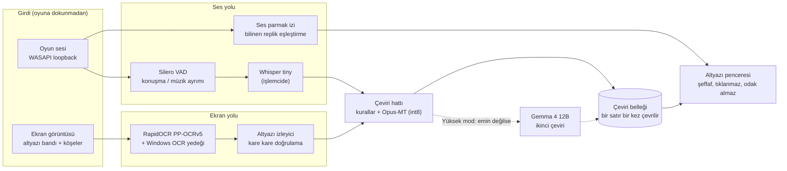
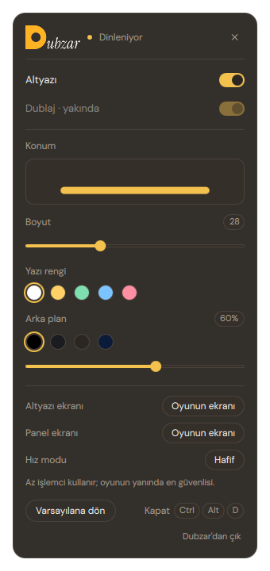
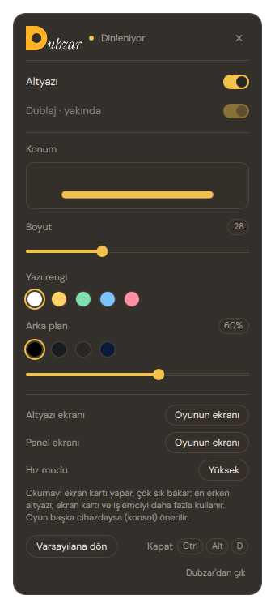

<p align="center">
  
</p>

<p align="center">
  <strong>Oyunun İngilizce konuşmasını ve ekrandaki yazısını okuyup, oyunun üzerinde Türkçe altyazı gösteren Windows uygulaması.</strong><br/>
  Oyunun dosyalarına, belleğine ya da ağ trafiğine dokunmaz. Her şey bu bilgisayarda çalışır.
</p>

<p align="center">
  
  
  
  
  
  
</p>

<p align="center">
  <a href="#neden-dubzar">Neden</a> ·
  <a href="#nasıl-çalışır">Nasıl çalışır</a> ·
  <a href="#özellikler">Özellikler</a> ·
  <a href="#hız-modları">Hız modları</a> ·
  <a href="#kurulum">Kurulum</a> ·
  <a href="#çeviri-kalitesi-ve-ölçüm">Ölçümler</a> ·
  <a href="#geliştirici-rehberi">Geliştirici rehberi</a>
</p>

---

## İçindekiler

- [Neden Dubzar?](#neden-dubzar)
- [Nasıl çalışır?](#nasıl-çalışır)
- [Özellikler](#özellikler)
- [Hız modları](#hız-modları)
- [Kurulum](#kurulum)
- [Kullanım](#kullanım)
- [Çeviri kalitesi ve ölçüm](#çeviri-kalitesi-ve-ölçüm)
- [Gizlilik ve güvenlik](#gizlilik-ve-güvenlik)
- [Bilinen sınırlar](#bilinen-sınırlar)
- [Komut satırı](#komut-satırı)
- [Ayarlar](#ayarlar)
- [Geliştirici rehberi](#geliştirici-rehberi)
- [Proje yapısı](#proje-yapısı)
- [Dokümanlar](#dokümanlar)
- [Yol haritası](#yol-haritası)
- [Lisanslar ve teşekkürler](#lisanslar-ve-teşekkürler)

---

## Neden Dubzar?

Çoğu oyunun Türkçe desteği yok. Olanların da çevirisi çoğu zaman eksik ya da zayıf. Mevcut çözümler genellikle şunlardan biri:

- **Oyun dosyasını yamalamak**: her oyun için ayrı bir emek, oyun güncellenince bozulur, çevrimiçi oyunlarda risklidir.
- **Bulut çeviri hizmetleri**: ekran görüntüsünü ya da sesi bir sunucuya gönderir, gecikme ve gizlilik sorunu getirir.
- **Elle altyazı çevirisi**: sonsuz zaman ister.

Dubzar farklı bir yoldan gider: **oyuna hiç dokunmaz**. Bilgisayarın çıkış sesini dinler ve ekranda oyunun kendi altyazısının durduğu bölgeye bakar. İngilizceyi bulur, bu bilgisayardaki küçük bir model ile Türkçeye çevirir ve oyunun üstünde, tıklamayı ve klavyeyi engellemeyen şeffaf bir pencerede gösterir.

| | Yama / mod | Bulut çeviri | **Dubzar** |
|---|:---:|:---:|:---:|
| Oyun dosyasına dokunmaz | ✗ | ✓ | **✓** |
| Her oyunda çalışır | ✗ | ✓ | **✓** |
| Veri bilgisayardan çıkmaz | ✓ | ✗ | **✓** |
| İnternet gerekmez | ✓ | ✗ | **✓** |
| Oyun güncellenince bozulmaz | ✗ | ✓ | **✓** |
| Altyazısı olmayan oyunda da çalışır | ✗ | ✓ | **✓** (ses dinlenir) |

<sub>Genel yaklaşımların tipik özellikleri; belirli bir ürün için farklı olabilir.</sub>

> [!NOTE]
> Dubzar erken sürümdür (0.2.x). Hangi şeyin ölçüldüğünü, hangisinin henüz ölçülmediğini aşağıda açıkça yazdık: [Çeviri kalitesi ve ölçüm](#çeviri-kalitesi-ve-ölçüm), [Bilinen sınırlar](#bilinen-sınırlar).

---

## Nasıl çalışır?

Dubzar aynı anda iki yoldan İngilizce metni bulur ve ikisini tek bir çeviri hattında birleştirir.



**Ekran yolu en doğru ve en hızlı yoldur.** Oyunun kendi İngilizce altyazısı açıksa Dubzar onu doğrudan okur. Ses yolu, altyazı olmayan ya da altyazısı yetersiz oyunlar için yedek olarak çalışır ve oynadıkça öğrenir: bir replik bir kez tanınıp çevrilince parmak izi saklanır, sonraki karşılaşmada altyazı henüz konuşma bitmeden görünür.

Adım adım ne olur:

1. **Bakış.** Oyun öndeyken (tam ekran ya da belirlediğin oyun işlemi) ekranın altındaki altyazı bölgesine ve sol/sağ üst köşelerdeki görev/amaç notlarına bakılır. Önce çok ucuz bir denetim yapılır: metin pikselleri değişmediyse pahalı okuma atlanır (yalnızca arada bir doğrulama okuması yapılır).
2. **Okuma.** RapidOCR (PP-OCRv5, İngilizce) altyazıyı okur, Windows'un kendi OCR'ı arkada güvenlik ağı olarak durur. Görüntü önce okumaya hazırlanır (oyun altyazıları küçük, yoğun sahne üstünde ve çoğunlukla açık yazı koyu kenarlıktır).
3. **Doğrulama.** Altyazı izleyici, birkaç kare boyunca aynı metni gördükten sonra "bu oyunun şu anki altyazısı" der. Kareler arası OCR titremeleri (`Iooking` / `looking`) aynı altyazı sayılır, kendi Türkçe altyazımız ise asla geri okunmaz.
4. **Hazırlık.** OCR'ın tipik hataları onarılır (I/l karışıklığı, harf yerine rakam), cümleler ve konuşmacı adları ayrılır (`Nate: Yeah.` → ad çevrilmez, cümle çevrilir).
5. **Çeviri.** Önce oyun arayüzüne özel kurallar ve küçük bir sabit bellek, sonra argo/deyim yeniden yazımları, sonra Opus-MT ile cümle cümle çeviri. Oyun metni oyuncuya "sen" diye seslenir: model "Rehineleri kurtarın." yazdığında kural tek kişiye çevirir.
6. **Gösterim.** Çeviri belleğe yazılır, şeffaf altyazı penceresinde gösterilir. Oyunun altyazısı ekrandan kalkınca bizimki de kalkar.

---

## Özellikler

<table>
<tr>
<td width="50%" valign="top">

### Okuma
- **Ekrandaki altyazıyı okur**: RapidOCR PP-OCRv5 (İngilizce) + Windows OCR yedeği.
- **Köşe notları**: sol/sağ üstteki görev hedefleri ve bildirimler değişince bir kez okunur, bir kez çevrilir.
- **Altyazı yoksa sesi dinler**: WASAPI loopback ile oyun sesi, Silero VAD ile konuşma/müzik ayrımı, Whisper tiny ile tanıma.
- **Oynadıkça öğrenir**: tanınan replikler ses parmak izi ile saklanır, sonra anında gösterilir.
- **Arka plan taraması**: oyun kapalıyken çıkarılmış ses dosyaları taranıp indeks büyütülür, oyun açılınca tarama durur.

</td>
<td width="50%" valign="top">

### Çeviri
- **Opus-MT (tc-big en→tr)**, CTranslate2 int8 ile işlemcide: tek satır ~0,07 sn.
- **Cümle cümle çevirir**, konuşmacı adını modelden ayrı tutar.
- **Oyun arayüzü kuralları**: `Press E to open the door` gibi istemler ve `Difficulty: Hard` gibi etiketler modele bırakılmaz.
- **Argo ve deyim yeniden yazımları**: İngilizce tarafta daha sade İngilizceye çevrilir (`take out the guard` → `kill the guard`).
- **"Sen" kipi**: emirler tek kişiye seslenir.
- **Terim sözlüğü**: kendi sözlük dosyanla karakter ve yer adlarını sabitle (`--glossary`).
- **Çeviri belleği**: bir satır bir kez çevrilir, tekrarında model hiç çalışmaz.

</td>
</tr>
<tr>
<td width="50%" valign="top">

### Gösterim
- **Şeffaf, tıklanmaz, odak almayan** pencere: oyunun girişi ve akışı bozulmaz.
- **Ekran görüntüsünden gizli**: kendi altyazın OCR tarafından geri okunmaz.
- **Her oyuna kendi ayarı**: boyut, konum, renk, ekran ve hız modu oyun bazında.
- **Oyun açılınca küçük bildirim**: NVIDIA/Discord gibi üstte kısa süre "ile ayarları aç" çıkar.
- **Panel oyunun üstünde kalır**: oyun kendini öne alsa da ayar paneli arkaya düşmez.

</td>
<td width="50%" valign="top">

### Hafiflik
- **Sağ alt simge (tray)**: arka planda çalışır; tıkla ayarlar, sağ tık altyazıyı aç/kapat ve çık.
- **Görev Yöneticisi'nde "Dubzar"** adı ve simgesiyle görünür.
- **Düşük öncelik**: işlemci sıkışınca oyun kazanır.
- **İki hız modu**: Hafif (işlemci) ve Yüksek (ekran kartı + büyük model).
- **Çevrimdışı**: kurulumdan sonra internet gerekmez.

</td>
</tr>
</table>

<p align="center">
  
  &nbsp;&nbsp;
  
</p>
<p align="center"><sub><b>Ctrl+Alt+D</b> ile açılan ayar paneli. Solda Hafif, sağda Yüksek mod. Altyazı boyutu, konumu, renkleri, hangi ekranda görüneceği ve hız modu burada.</sub></p>

---

## Hız modları

İki mod var. İkisi de oyunu kapamadan paneldeki **Hız modu** düğmesinden değişir, yazı okuyucu hemen işlemci ve ekran kartı arasında geçer.

| | **Hafif** (varsayılan) | **Yüksek** |
|---|---|---|
| Yazı okuma | İşlemci | Ekran kartı (NVIDIA, CUDA) |
| Bakış sıklığı | 0,12 sn (sessizken 0,30 sn) | 0,06 sn (sessizken 0,12 sn) |
| Çeviri | Opus-MT, işlemci | Opus-MT + **Gemma 4 12B** ikinci çeviri |
| Gemma ne zaman? | Hiç | Opus-MT'nin emin olmadığı cümlelerde |
| Altyazı gecikmesi (ölçülen) | ≈ 1,0 sn | ≈ 0,4 sn (zor satırda +0,5-0,7 sn) |
| Bellek | ≈ 1 GB RAM, ekran kartı kullanmaz | ≈ 1,5 GB RAM + **~7 GB ekran kartı belleği** |
| Ne zaman? | Oyunla aynı bilgisayarda | Güçlü kart (12 GB+) ya da oyun başka cihazdaysa |

> [!IMPORTANT]
> Yüksek mod ekran kartında yaklaşık 7 GB boş bellek ister. Boş bellek yetmezse, model dosyaları yoksa ya da NVIDIA kart bulunamazsa Gemma açılmaz ve Dubzar sessizce Opus-MT ile devam eder. Altyazı hiçbir zaman büyük modelin yavaşlığı ya da hatası yüzünden gecikmez: Gemma 2,5 saniyede cevap vermezse ya da anlamsız cevap verirse (boş, çok uzun, İngilizceyi geri yazarsa) Opus-MT çevirisi kullanılır.

**Hibrit nasıl çalışır?** Opus-MT her cümleyi çevirirken kendi güvenini de verir (toplam log-olasılık). Güven eşiğin (`UNSURE_BELOW = -3.8`) altındaysa cümle Gemma'ya gider. 200 satırlık geliştirme kümesinde bu eşik, satırların en emin olmayan yaklaşık %40'ını ve Opus-MT'nin ciddi hatalarının yaklaşık %60'ını yakalıyor.

---

## Kurulum

### Gereksinimler

| | Hafif mod | Yüksek mod |
|---|---|---|
| İşletim sistemi | Windows 10 (2004+) / 11 | aynı |
| Python | 3.12 (yoksa kurulum izninle `winget` ile kurar) | aynı |
| Disk | ≈ 1,2 GB | ≈ 1,2 GB + ≈ 7,5 GB (Gemma modeli ve çalışma dosyaları) |
| Ekran kartı | gerekmez | NVIDIA, ≥ 7 GB boş video belleği |
| İnternet | kurulum için gerekmez (çevrimdışı paket) | aynı |

### Kurulum paketinden (önerilen)

1. `Dubzar-Kurulum-<sürüm>.zip` dosyasını bir klasöre **tamamen çıkar** (içinden çift tıklama).
2. `Kur.bat` dosyasına çift tıkla ve soruları yanıtla. Soruların ayrıntısı aşağıda.
3. Masaüstünde **Dubzar** simgesi belirir. Çift tıkla, sonra oyunu aç.

Paket çevrimdışıdır: Python paketleri (wheel), çeviri modeli (int8'e çevrilmiş), Whisper tiny ve OCR modelleri zip'in içindedir, kurulum **hiçbir şey indirmez**. Bir geliştirme bilgisayarında kurulum yaklaşık 2 dakika sürdü (zip'i indirme süresi hariç).

<details>
<summary><strong>Kurulumun sorduğu sorular</strong></summary>

- **Devam edilsin mi?** Kurulum yeri: `%LOCALAPPDATA%\Dubzar`.
- **Python 3.12 bulunamazsa** `winget` ile kurmayı önerir.
- **Ekran kartı hızlandırması** (yalnızca NVIDIA kartı olanlara sorulur): `onnxruntime-gpu` ve CUDA kütüphaneleri için yaklaşık **1,5 GB ek indirme**, diskte ~2,5 GB. Hayır dersen Yüksek mod yazıyı yine işlemciyle okur ama Gemma ikinci çeviri çalışır.

</details>

<details>
<summary><strong>Yüksek mod için büyük model dosyaları</strong></summary>

Gemma 4 12B (4-bit, `gemma-4-12b-it-qat-q4_0.gguf`, ~7 GB) ve llama.cpp sunucusu kurulum paketinin içinde **yoktur**. Dubzar bunları şu yerlerde arar:

| Dosya | Varsayılan konum | Ortam değişkeni |
|---|---|---|
| `llama-server.exe` (+ ilgili DLL'ler, CUDA 12 `cudart`/`cublas`) | `%LOCALAPPDATA%\Dubzar\llama\` | `DUBZAR_LLAMA_SERVER` |
| `gemma-4-12b-it-qat-q4_0.gguf` | `%LOCALAPPDATA%\Dubzar\models\` | `DUBZAR_QUALITY_MODEL` |

Dosyalar yoksa Yüksek mod yalnızca ekran kartıyla yazı okur. Bu dosyaların nasıl dağıtılacağı (izinle indirme) henüz yapılmadı, [Yol haritası](#yol-haritası).

</details>

### Kaldırma

`Kaldir.bat` dosyasına çift tıkla. Ayarlarını ve modelleri silmek isteyip istemediğini sorar.

---

## Kullanım

1. **Dubzar simgesine çift tıkla.** Ekranda kısa bir logo animasyonu çıkar, program sağ alttaki bildirim alanında (tray) arka planda çalışmaya başlar.
2. **Oyunu aç.** Tam ekran ya da pencereli tam ekran (borderless) olabilir. Oyun açılınca üstte kısa bir bildirim çıkar.
3. **Oyunun kendi İngilizce altyazısını aç.** Dubzar en doğru ve en hızlı bu yolla çalışır. Altyazı yoksa sesi dinler (daha yavaş, daha az doğru).
4. **Ayarlar için `Ctrl+Alt+D`** (ya da tray simgesine tıkla): boyut, konum, renk, arka plan, hangi ekranda, hız modu.
5. **Çıkmak için** tray simgesine sağ tıkla → **Dubzar'dan çık** (panelde de aynı bağlantı var).

| Kısayol / eylem | Ne yapar |
|---|---|
| `Ctrl+Alt+D` | Ayar panelini açar/kapatır (ayar dosyasından değiştirilebilir) |
| Tray simgesi, sol tık | Ayar panelini açar |
| Tray simgesi, sağ tık | Altyazıyı aç/kapat, ayarlar, çıkış |
| Panelde üst bölüm | Paneli sürükleyerek taşı |
| `Esc` | Paneli kapatır (panel odaktayken) |

**Sorun olursa:** Başlat menüsündeki **"Dubzar (hata ayiklama)"** ile açıp konsol çıktısını gönder ya da `%APPDATA%\Dubzar\dubzar.log` dosyasını paylaş.

---

## Çeviri kalitesi ve ölçüm

Dubzar'ı kalite iddiasını **ölçerek** geliştiriyoruz. Aşağıdakiler neyin nasıl ölçüldüğünü ve sonuçların sınırlarını da içerir.

### Nasıl ölçüyoruz?

- **Geliştirme kümesi**: 200 satır (konuşma, argo, görev metni, resmî dil, arayüz). Bir insan her çıktıyı *düzgün / küçük sorun / ciddi hata* olarak puanladı ([`experiments/rating/`](experiments/rating)).
- **Hold-out kümesi**: modelin ve kuralların hiç görmediği 150 yeni cümle, çeviri/eğitim verisinden önce ayrıldı.
- **Yapay hakem**: bir dil modeli hakemi, insanın puanlarıyla karşılaştırılarak kalibre edildi (257 satırda "ciddi hata var/yok" ayrımında %86 örtüşme), böylece her denemede insanı yormadan model kıyaslanabiliyor.
- **Otomatik ölçü (chrF)** yalnızca ek sinyal. Referans çeviriler tek ve kusurlu olduğu için karar insan puanıyla verilir.

### Sonuçlar

| Ölçüm | Sonuç |
|---|---|
| Opus-MT, 120 satırlık kıyas (chrF) | 66,7, arayüz kuralları sonrası 68,4 |
| Opus-MT + kurallar, 200 satır, insan puanı | **%62,5 düzgün, %17 ciddi hata** |
| Hy-MT2-1.8B (ikinci model) | Aynı kümede **daha kötü** (chrF 62,0, 6-7 kat yavaş), hibritte düzgün %60,5, ciddi %20 |
| Opus-MT ince ayarı (6 bin çift veri), 200 satır | %62,5 → %74 düzgün (geliştirme kümesi) |
| Aynı ince ayar, **taze hold-out** | Düzgün 98 → 99 / 150, ciddi 37 → 31: **kazanç küçük ve belirsiz** |
| Yüksek mod (Gemma 4 12B), hold-out, yapay hakem | **%72 düzgün / %10 ciddi** (Opus-MT: %56 / %28) |

> [!WARNING]
> **İnce ayarın geliştirme kümesindeki kazancı hold-out'ta tekrarlanmadı.** O kümede defalarca iterasyon yaptığımız için sayı iyimserdi. Bu yüzden ince ayarlı model ürüne konmadı; kalite arttırma işini büyük modele (Yüksek mod) ve kural katmanına yönelttik. Yüksek moddaki kazanç 60 satırlık bir insan kontrolüyle de doğrulandı (30 cümlede Gemma 18 kez daha iyi, 9 eşit, 3 kez daha kötü), ama bu tek bir geliştirme bilgisayarında ve sınırlı satırda yapıldı.

**Hedefimiz** gerçek oyun satırlarında ≥ %90 düzgün, ≤ %3 ciddi hata. Henüz orada değiliz.

### Neyi ölçmedik?

- Gerçek oyunlarda **oyunun FPS'ine etkisi** (Hafif için hedef: %3'ten az). Ölçüm betiği planlandı, kayıt bekliyor.
- Ses yolunun gerçek oyun sesinde, müzik ve efekt altındaki doğruluğu.
- Farklı yazı tiplerinde, çok renkli ve hareketli altyazılarda okuma doğruluğunun geniş bir oyun kümesinde dökümü.

---

## Gizlilik ve güvenlik

- **Her şey yerelde çalışır.** Ses ve ekran görüntüsü hiçbir yere gönderilmez; modeller bu bilgisayarda.
- **Oyuna dokunmaz.** Oyun belleğini okumaz, dosyasını değiştirmez, işlemine kod enjekte etmez, ağ trafiğine karışmaz. Yalnızca bilgisayarın çıkış sesini ve ekran görüntüsünü, bir ekran kaydı programının yaptığı gibi alır.
- **Anti-hile sistemleri için garanti verilemez.** Oyuna müdahale etmediği için risk düşüktür, ama çevrimiçi/rekabetçi oyunlarda kendi sorumluluğunda kullan.
- **Kendi penceresi yakalamadan gizlidir** (`WDA_EXCLUDEFROMCAPTURE`): Türkçe altyazı ekran kaydına ve kendi OCR'ına girmez.
- **Büyük model yalnızca yerel bir sunucudur** (`127.0.0.1`). Hiçbir uzak adrese istek atmaz.
- **İndirme izinle yapılır.** Modeller `--allow-download` verilmedikçe indirilmez, eksikse net bir hata verir.

---

## Bilinen sınırlar

- **Yalnızca Windows 10/11.** Ses yakalama (WASAPI), ekran yakalama ve pencere işlemleri Windows'a özel.
- **Yalnızca İngilizce → Türkçe.**
- **Özel tam ekran (exclusive fullscreen) oyunlar:** hiçbir pencere üstte gösterilemez, ekran da yakalanamayabilir. Oyunu "pencereli tam ekran" (borderless) çalıştır.
- **Konsol (PlayStation, Xbox):** konsolun görüntüsü yalnızca HDMI kablosunda olduğu için Dubzar'ın okuyabilmesi için bir **yakalama kartı ve Windows bilgisayar** gerekir. Yalnızca TV'ye kurulan bir uygulama konsolun görüntüsünü okuyamaz.
- **Ses yolu** yedektir: altyazı olmayan oyunlarda daha yavaş ve daha az doğrudur (Whisper tiny, işlemci).
- **Çeviri hâlâ hata yapar.** Özellikle argo, deyim ve oyuna özgü terimler. Bir satır bir kez çevrilince hatırlandığı için yanlış bir satır tekrarlayabilir.
- **Dublaj** ("Dublaj · yakında" olarak panelde soluk) henüz yok.
- **Hafif mod en hafif olsa da** yazı okuma işlemcide çalıştığı için altyazı değiştiğinde kısa süreli işlemci yükü olur.

---

## Komut satırı

Kurulum paketi `Dubzar` simgesini hazırlar. Komut satırı geliştirme ve tanı içindir.

```bash
python -m dubzar setup --allow-download       # modelleri bir kez indir
python -m dubzar run                          # canlı mod
python -m dubzar run --debug                  # ne olduğunu ekrana yaz
python -m dubzar run --performance high       # Yüksek mod
python -m dubzar scan <ses klasörü>           # çıkarılmış ses dosyalarından indeks oluştur
```

<details>
<summary><strong><code>run</code> seçenekleri</strong></summary>

| Seçenek | Anlamı |
|---|---|
| `--performance {light,high}` | Bu çalıştırma için hız modu |
| `--debug` | Ses seviyesi, yakalanan parçalar, okuma nedenleri, altyazının neden gösterilmediği |
| `--no-screen-ocr` | Ekrandaki altyazıyı okuma, yalnızca sesi dinle |
| `--game-exe GTA5.exe` | Oyunun işlem adı (altyazıyı yalnızca o öndeyken okur, taramayı oyun açıkken bekletir) |
| `--audio-dir <klasör>` | Çıkarılmış ses dosyaları: oyun kapalıyken arka planda taranır |
| `--scan-model small` | Arka plan taraması için Whisper modeli |
| `--whisper-model tiny` | Canlı tanıma modeli (tiny, base, small ...) |
| `--device {cpu,auto}` | Konuşma tanıma cihazı (`auto` ekran kartını dener) |
| `--cpu-threads N` | Modellerin kullanacağı işlemci iş parçacığı (varsayılan 2; oyuna çekirdek kalsın) |
| `--glossary dosya.json` | Terim sözlüğü: `{"İngilizce": "Türkçe"}` |
| `--memory dosya.db` | Çeviri belleği dosyası (varsayılan `%APPDATA%\Dubzar\translations.db`) |
| `--index dosya.db` | Replik indeksi (varsayılan `%APPDATA%\Dubzar\live.db`) |
| `--settings-file dosya.json` | Ayar dosyası (varsayılan `%APPDATA%\Dubzar\settings.json`) |
| `--log-file dosya` | Konsol yoksa çıktının yazılacağı dosya |
| `--font-size`, `--position`, `--screen` | Bu çalıştırma için altyazı görünümü |
| `--allow-download` | Eksik modellerin indirilmesine izin ver |

</details>

---

## Ayarlar

Ayarlar `%APPDATA%\Dubzar\settings.json` dosyasında saklanır, panel her değişikliği kaydeder. Her ayar doğrulanır, geçersiz değer reddedilir ve eskisi korunur.

| Ayar | Anlamı | Varsayılan |
|---|---|---|
| `subtitles_enabled` | Altyazı açık/kapalı | `true` |
| `font_size` | Altyazı boyutu (12-96) | `28` |
| `vertical` | Konum (0 üst, 1 alt) | `0.80` |
| `text_color`, `background_color` | Yazı ve arka plan rengi | `#FFFFFF`, `#000000` |
| `background_opacity` | Arka plan opaklığı (yüzde) | `60` |
| `screen`, `panel_screen` | Altyazının ve panelin ekranı (`auto` = oyunun ekranı, `primary`, `1`, `2`...) | `auto` |
| `hotkey` | Panel kısayolu | `Ctrl+Alt+D` |
| `performance` | `light` veya `high` | `light` |
| `game_exe` | Oyunun işlem adı | boş |
| `profiles` | Oyun bazında kendi ayarları | `{}` |

---

## Geliştirici rehberi

### Kurulum

```bash
git clone https://github.com/ridvan-byr/dubzar.git
cd dubzar
python -m venv .venv
.venv\Scripts\activate
pip install -e ".[dev,asr,ocr,translate]"
```

Çeviri, tanıma ve yazı okuma modelleri ayrıca iner: `python -m dubzar setup --allow-download`.

### Çalıştırma ve test

```bash
python -m dubzar run --debug          # canlı mod, ayrıntılı çıktı
python -m pytest                      # hızlı testler (548 geçiyor), model ve donanım gerektirmez
python -m pytest -m slow              # gerçek model ve donanım gerektiren testler
```

> [!TIP]
> Testler gerçek modele ihtiyaç duymaz: çeviri, tanıma ve OCR motorları enjekte edilebilir (`backend=`, `model_factory=`, `engine=`). Qt testleri `QT_QPA_PLATFORM=offscreen` ile çalışır.

### Mimari ilkeleri

- **Dikişler (seam).** Her gerçek model ya da donanım çağrısı, testte sahtesi verilebilen bir fonksiyon/parametre arkasındadır.
- **Hata yerine geri çekilme.** Büyük model, GPU okuyucu, CUDA kütüphaneleri gibi isteğe bağlı parçalar başarısız olursa yerine bir basit parça geçer; altyazı hiçbir zaman isteğe bağlı bir parçanın yüzünden gecikmez.
- **Oyuna öncelik.** Süreç düşük öncelikte çalışır, iş parçacığı sayıları sınırlıdır, boştaki iş parçacıkları meşgul beklemez.
- **Ölçmeden iddia yok.** Hız ve kalite değişiklikleri `experiments/` altında bir ölçümle birlikte gelir.
- **Her değişiklikte test.** Hata düzeltmeleri önce hatayı yakalayan bir testle yazılır.

### Yeni bir çeviri kuralı eklemek

Oyun arayüzü ve emir kipi kuralları kod içinde, testleriyle birlikte durur:

| Ne eklenecek | Nereye | Test |
|---|---|---|
| Çok yaygın bir arayüz satırının sabit çevirisi | [`gameterms.py`](dubzar/gameterms.py) | `tests/test_gameterms.py` |
| Argo ya da deyimin daha sade İngilizce karşılığı | [`rewrites.py`](dubzar/rewrites.py) | `tests/test_rewrites_register.py` |
| Emir fiili (tek kişiye "sen" kipi) | [`register.py`](dubzar/register.py) | `tests/test_rewrites_register.py` |
| Konuşmacı adı sanılmaması gereken etiket (`Difficulty:`) | [`textsplit.py`](dubzar/textsplit.py) | `tests/test_textsplit.py` |

---

## Proje yapısı

```text
dubzar/
├── app.py              Canlı uygulama: pencereler, kısayol, tray, hız modu geçişi
├── cli.py              Komut satırı (setup, scan, run)
├── live.py             Canlı hat: bilinen replik / bilinmeyen replik, öğrenme
├── capture.py          Oyun sesi yakalama (WASAPI loopback)
├── segmenter.py, vad.py  Konuşma parçalama, Silero VAD
├── asr.py              Whisper ile tanıma
├── fingerprint.py      Ses parmak izi ve akışlı eşleştirici
├── index.py, scan.py, background.py   Replik indeksi ve arka plan taraması
├── screen.py           Ekran yakalama (bölgesel GDI), oyun/monitör bulma
├── screen_source.py    Ekrandaki altyazıyı okuyup çeviren kaynak
├── subtitle_tracker.py Kare kare "şimdiki altyazı" kararı
├── region_notes.py     Köşe notları (görev hedefleri)
├── ocr.py, ocr_rapid.py   Windows OCR, RapidOCR (PP-OCRv5)
├── imageprep.py, textmask.py, textfix.py   OCR öncesi/sonrası onarım
├── layout.py           Okunan satırlardan diyalog bloğunu seçme
├── textsplit.py        Cümle ve konuşmacı ayırma
├── translate.py        Opus-MT (CTranslate2 int8), sözlük, ikinci görüş kancası
├── gameterms.py, rewrites.py, register.py   Oyuna özel çeviri kuralları
├── memory.py           Çeviri belleği (SQLite)
├── quality_model.py    Gemma 4 12B sunucusu (Yüksek mod)
├── performance.py      Hafif / Yüksek mod profilleri
├── profiles.py         Oyun bazında ayar
├── settings.py         Doğrulanan, gözlenebilen, kaydedilen ayarlar
├── overlay.py, overlay_window.py   Altyazı zamanlaması ve penceresi
├── gamewatch.py, hotkey.py, priority.py, branding.py   Oyun algılama, kısayol, öncelik, Görev Yöneticisi adı
└── ui/                 Qt Quick paneli, açılış animasyonu, tray, yazı tipleri
installer/              Çevrimdışı kurulum paketi (Kur.bat, kur.ps1, build_zip.py)
site/                   Tanıtım ve satış sitesi (statik HTML)
tests/                  548 hızlı test
experiments/            Ölçüm ve kıyas betikleri, insan puanlama araçları
training/               Çeviri modeli ince ayarı ve veri araçları (deneysel)
docs/                   Tasarım, planlar, ölçümler, lisanslar
```

### Kurulum paketini üretmek

```bash
python installer/build_zip.py        # dist/Dubzar-Kurulum-<sürüm>.zip
```

`dist/wheels` klasörü `pip wheel -r installer/requirements.txt -w dist/wheels` ile hazırlanır, modeller bu bilgisayardan alınır.

---

## Dokümanlar

| Doküman | İçinde ne var |
|---|---|
| [`docs/superpowers/specs/2026-11-20-turkce-oyun-dublaj-altyazi-design.md`](docs/superpowers/specs/2026-11-20-turkce-oyun-dublaj-altyazi-design.md) | Ürünün tasarımı ve kapsamı |
| [`docs/superpowers/specs/2026-11-21-quality-and-measurement-plan.md`](docs/superpowers/specs/2026-11-21-quality-and-measurement-plan.md) | Kalite ve ölçüm planı, kıyaslama sonuçları |
| [`docs/design/logo.md`](docs/design/logo.md) | Logo fikri ve dosyaları |
| [`docs/design/overlay-design-system.md`](docs/design/overlay-design-system.md) | Altyazı ve panel tasarım sistemi |
| [`docs/SMOKE_TEST.md`](docs/SMOKE_TEST.md) | Gerçek bileşenlerle duman testi sonuçları |
| [`docs/BACKLOG.md`](docs/BACKLOG.md) | Yapılacaklar |
| [`docs/LICENSES.md`](docs/LICENSES.md) | Kullanılan modellerin ve yazı tiplerinin lisansları |
| [`installer/OKU-BENI.txt`](installer/OKU-BENI.txt) | Son kullanıcı için kurulum ve kullanım notu |

---

## Yol haritası

- [x] Canlı mod: ekrandan okuma + ses yolu, çeviri belleği, öğrenme
- [x] Ayar paneli, oyun bazında ayar, tray, oyun açılış bildirimi
- [x] Çevrimdışı kurulum paketi, Görev Yöneticisi adı
- [x] Hafif ve Yüksek mod, Gemma 4 12B ikinci çeviri
- [ ] Gerçek oyunlarda FPS ve işlemci etkisi ölçümü
- [ ] Yüksek mod büyük model dosyalarının izinle indirilmesi (kurulumda)
- [ ] Çeviri kalitesinin ≥ %90 düzgün hedefine yaklaştırılması
- [ ] Lisans anahtarı ve toplu dağıtıma karşı koruma
- [ ] Ödeme altyapısı ve satış
- [ ] Dublaj: karakter sesi, süre eşleme, dublaj klipleri
- [ ] Android TV için sürüm araştırması (yalnızca TV'nin kendi oyunları)

---

## Lisanslar ve teşekkürler

Dubzar aşağıdaki açık kaynak bileşenlerin üzerine kurulu. Ticari kullanıma uygun olduklarını lisans metinlerinden doğruladık ([`docs/LICENSES.md`](docs/LICENSES.md)). Bu bir hukuki görüş değildir.

| Bileşen | Ne için | Lisans |
|---|---|---|
| [OPUS-MT](https://huggingface.co/Helsinki-NLP/opus-mt-tc-big-en-tr) (Helsinki-NLP) | İngilizce → Türkçe çeviri | CC-BY-4.0 |
| [Whisper](https://github.com/openai/whisper) / [faster-whisper](https://github.com/SYSTRAN/faster-whisper) | Konuşma tanıma | MIT |
| [CTranslate2](https://github.com/OpenNMT/CTranslate2) | Hızlı çıkarım | MIT |
| [RapidOCR](https://github.com/RapidAI/RapidOCR) ve PaddleOCR PP-OCR modelleri | Ekrandan yazı okuma | Apache-2.0 |
| [Silero VAD](https://github.com/snakers4/silero-vad) | Konuşma/müzik ayrımı | MIT |
| [Qt for Python (PySide6)](https://doc.qt.io/qtforpython-6/) | Arayüz | LGPL-3.0 |
| [DM Sans](https://github.com/google/fonts/tree/main/ofl/dmsans), [Instrument Serif](https://github.com/google/fonts/tree/main/ofl/instrumentserif) | Yazı tipleri | SIL OFL 1.1 |
| [llama.cpp](https://github.com/ggml-org/llama.cpp) | Büyük modeli çalıştıran sunucu (Yüksek mod) | MIT |
| Gemma 4 | Yüksek modda ikinci çeviri | Gemma kullanım şartları (dağıtımdan önce okunmalı) |

**Kaynak belirtme (CC-BY-4.0):** Çeviri modeli, Helsinki-NLP / Tiedemann ve ekibinin OPUS-MT modelinin CTranslate2 biçimine dönüştürülmüş ve int8 olarak nicemlenmiş (değiştirilmiş) halidir.

Ticari olarak kullanılamayan modeller (NLLB-200, XTTS) bilerek seçilmedi.

---

<p align="center">
  <br/>
  <sub>© 2026 Dubzar. Tüm hakları saklıdır.</sub>
</p>
